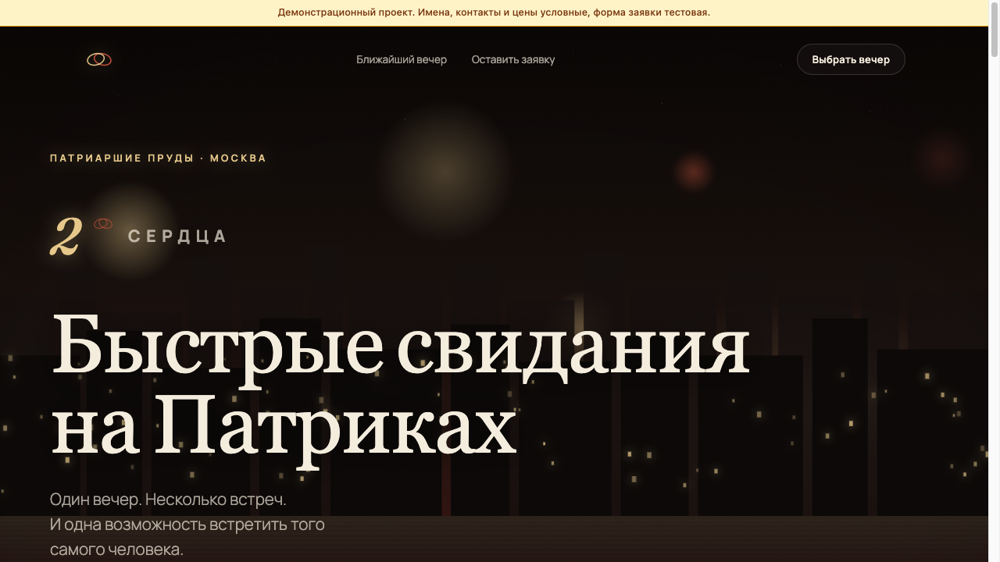

# 2 СЕРДЦА — быстрые свидания

Лендинг вечеров быстрых свиданий на Патриарших прудах, Москва.

> **Демонстрационный проект.** Имена, контакты, адреса и цены на сайте условные и показаны как пример; форма заявки тестовая.

**Онлайн:** https://twohearts.gonka.blog



## Что внутри

- Атмосферный экран: огни города, зернистость плёнки, плавные переходы
- Блок ближайшего вечера и форма заявки (имя и почта)
- Адрес скрипта вынесен в `config.js`

## Стек

чистые HTML / CSS / JavaScript, Google Apps Script, Google Таблицы. Сборка не нужна: это статические файлы.

## Запуск

`cd frontend && python3 -m http.server 8000`

## Форма заявок

Форма отправляет данные в веб-приложение Google Apps Script. Скрипт записывает строку в Google Таблицу и присылает письмо. Код лежит в папке `backend/`.

1. Создайте проект в Google Apps Script и вставьте код из `backend/`.
2. Укажите свою почту для уведомлений и разверните как веб-приложение (доступ: «Все»).
3. Вставьте полученный адрес `/exec` в настройки сайта (в `index.html`, `script.js` или `config.js`, смотря где он указан).

В демонстрационной версии телефоны, почты и имена условные.

## Структура

```
twohearts/
├── backend/
├── frontend/
└── docs/            скриншоты
```

## Автор

Олег, [GitHub: textsmen-design](https://github.com/textsmen-design).
